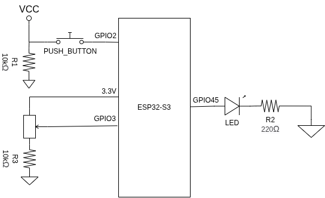

    <h1>Atividade 09: Monitoramento Analógico (ADC) e Controle de Potência (PWM)</h1> 

## Objetivo
Compreender a conversão analógico-digital através do periférico ADC (Analog-to-Digital
Converter) do ESP32, convertendo níveis de tensão (0 V a 3,3 V) em valores numéricos
digitais. Implementar o remapeamento desses dados para controle de brilho/potência de um
LED via PWM (LEDC) e aplicar uma rotina de travamento de estado ("Hold") acionada por
botão.

### Materiais utilizados
* 1 ESP32 (DevKit)
* 1 Potenciometro 10 kΩ + 1 Resistor 10 kΩ
* 1 LED + 1 Resistor de 220 Ω
* 1 Button + 1 Resistor 10 kΩ
* Protoboard e cabos

### Parâmetros de Configuração
__ADC__: Apresente os parâmetros escolhidos para atenuação e resolução do ADC no ESP-IDF (ex: Atenuação de 12 dB para leitura de até 3,3 V e resolução de 12 bits  faixa de 0 a 4095).
__LEDC (PWM)__: Apresente a frequência de amostragem configurada para o LED (ex: 5 kHz) e a resolução do Duty Cycle (ex: 10 bits — faixa de 0 a 1023 ).
__Equação de Conversão__: Apresente a equação matemática utilizada para converter o valor bruto lido pelo ADC (Vraw) em tensão calculada em milivolts (VmV).

## Diagrama Esquemático
Circuito esquemático do dispositivo indicando claramente as conexões do potenciômetro (no pino do ADC), do LED (no pino configurado para PWM) e do botão de controle.

## Simulação no Wokwi
> `https://wokwi.com/projects/478314208707954689`

## Montagem Física Final

## Solução Implementada
Disponível em [`main.c`](./main.c)

